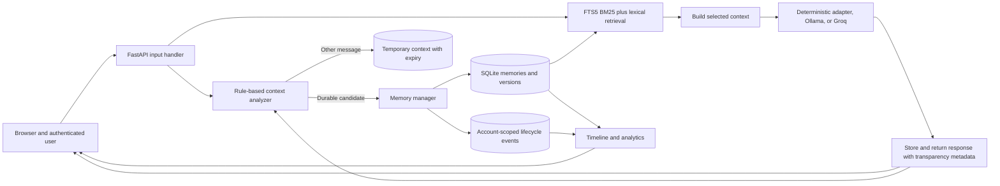
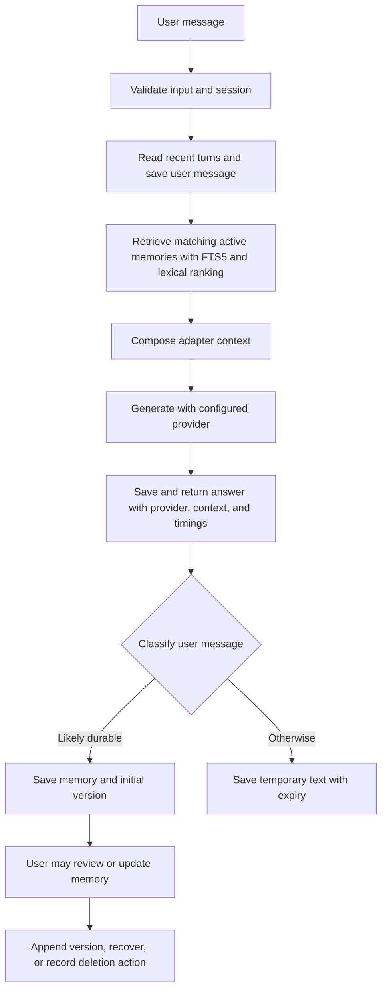

<div align="center">

# Memory Atlas

### An efficient, transparent, and user-controlled memory layer for long-running AI agents.

</div>

Memory Atlas explores how an AI agent can preserve useful information across conversations without repeatedly resending a growing transcript. It combines persistent, versioned memories with selective context retrieval and user controls for inspecting and changing what is kept.

This is a local proof of concept, not a new LLM or a conventional full-history chatbot. Memory decisions use inspectable rules and validated model analysis; retrieval combines SQLite FTS5 token search with lexical scoring. The default response provider is deterministic development mode; Ollama and Groq can be configured for LLM responses.

[](https://www.python.org/)
[](https://fastapi.tiangolo.com/)
[](https://www.sqlite.org/)
[](#project-status-and-future-work)

## Screenshots

No genuine screenshot of the current interface has been captured. Add images here after running the application in a browser. Use relative paths for repository images and a clean demo account; never publish credentials or private memories.

## Contents

- [Features](#features)
- [Architecture](#architecture)
- [Technology stack](#technology-stack)
- [Repository structure](#repository-structure)
- [Getting started](#getting-started)
- [Model configuration](#model-configuration)
- [How to use the application](#how-to-use-the-application)
- [API reference](#api-reference)
- [Testing and evaluation](#testing-and-evaluation)
- [Privacy, security, and limitations](#privacy-security-and-limitations)
- [Project status and future work](#project-status-and-future-work)
- [Contributing](#contributing)
- [License and acknowledgments](#license-and-acknowledgments)

## Features

| Area | Implemented behavior |
|---|---|
| AI Assistant | Authenticated chat, persistent conversation records, loading/error feedback, and a context inspector. |
| Conversation history | Multiple account-owned chats with automatic first-message titles, manual rename, ordered reload, and confirmed deletion. Conversation deletion removes its messages only; long-term memories remain separate. |
| Natural-language memory interpretation | With Groq configured, a lightweight local gate identifies likely personal assertions and personal-memory questions. Those messages receive a structured analysis for assertion type, user relevance, confidence, polarity, normalized candidate, and search terms. Python validates the output before use; only explicit, high-confidence personal assertions are retained. |
| Hybrid memory retrieval | SQLite FTS5 token matching/BM25 is combined with lexical overlap and priority. For analyzed messages, validated Groq-generated search terms expand the query. Deleted and temporary records are excluded, and retrieval is scoped to the signed-in user. |
| Safe Markdown responses | Assistant output is rendered with locally served, pinned Marked and DOMPurify builds. Sanitized Markdown supports headings, paragraphs, lists, tables, inline code, and fenced code. User messages remain plain text. |
| Safe fallback | If analysis fails or is malformed, chat continues with local phrase rules and ordinary lexical retrieval. Deterministic and Ollama modes do not call Groq for analysis. Questions, hypotheticals, likely jokes, and uncertainty are excluded by local fallback checks where recognizable. |
| Summarization and temporary context | When the stored message count reaches eight or more, recent user turns are condensed into an extractive summary. Other text is stored temporarily with a 24-hour expiry. Temporary rows are not independently retrieved into later prompts. |
| Memory controls | Search, category filtering, add, view, edit, version history, restore-as-new-version, soft delete, recovery, and confirmed permanent deletion. |
| Memory Universe | Interactive SVG nodes show actual active memories. A line appears only when two entries share at least two meaningful words; relationships are lexical and explainable, not semantic inference. An accessible list is available as an alternative. |
| Memory timeline | Existing version records show creation and edits. Delete, recovery, permanent-delete, and restore events are recorded going forward; past events that were never logged cannot be reconstructed. |
| Analytics | Account-scoped active/deleted counts, category totals, version count, and recorded lifecycle-event count. These are record statistics, not model-quality metrics. |
| Context Inspector | Shows response provider/model, request text, retrieved memories and reasons, adapter context, character-based token estimates, and measured retrieval and generation duration. |
| Model adapter | Clearly labeled deterministic development responses by default; optional local Ollama or GroqCloud inference. Provider keys remain server-side. No model downloads automatically. |
| Authentication and ownership | PBKDF2 password hashes, expiring bearer sessions, and owner-scoped API operations. |

## Architecture



### Chat and memory-update flow



Retrieval combines SQLite FTS5 token matching/BM25, lexical overlap, and priority; validated Groq query expansion is available only for likely memory-related messages. It does not use embeddings and may miss paraphrases without shared terms or model-expanded terms. `GET /api/health` reports the configured provider and model label, not whether an Ollama service is reachable. The inspector shows the exact prompt for Ollama and the inputs actually used by deterministic mode.

| Component | Code |
|---|---|
| Input handling, routes, and chat flow | `app/main.py` |
| Authentication and session ownership | `app/auth.py`, `app/main.py` |
| Classification, lifecycle, retrieval, timeline, analytics | `app/memory.py` |
| SQLite schema and additive initialization | `app/db.py` |
| Deterministic/Ollama/Groq provider adapter | `app/agent.py` |
| User interface | `static/index.html`, `static/style.css`, `static/app.js` |

More implementation detail is in [ARCHITECTURE.md](ARCHITECTURE.md).

## Technology stack

- **Python 3.10+ and FastAPI** for a small, testable backend with interactive OpenAPI docs.
- **SQLite** for local persistence without a separate database service. Initialization adds missing tables and indexes; it does not drop or recreate existing tables.
- **HTML, CSS, and vanilla JavaScript** for a responsive interface without a frontend build toolchain. Pinned Marked and DOMPurify browser builds are vendored under `static/vendor/` and served by FastAPI; their license texts are included beside the files.
- **Ollama (optional)** for local model generation, or **GroqCloud (optional)** for hosted OpenAI-compatible chat completions. Both are selected through the backend adapter; Groq uses the existing `requests` dependency.
- **`unittest` and pytest** for automated checks.

## Repository structure

```text
.
|-- app/
|   |-- __init__.py       # Loads local .env configuration
|   |-- agent.py          # Deterministic/Ollama/Groq adapter and prompt construction
|   |-- auth.py           # Registration, password hashing, bearer sessions
|   |-- db.py             # SQLite schema and additive initialization
|   |-- main.py           # FastAPI routes and chat lifecycle
|   `-- memory.py         # Classification, retrieval, versions, events, analytics
|-- evaluation/
|   |-- cases.json        # Small synthetic test set
|   `-- run.py            # Full-history vs selective-context evaluation
|-- static/
|   |-- app.js            # Chat, navigation, graph, memory and data views
|   |-- index.html        # Memory Atlas interface
|   |-- style.css         # Responsive midnight-indigo and violet theme
|   `-- vendor/           # Pinned Marked/DOMPurify builds and license texts
|-- tests/
|   |-- test_agent.py     # Provider tests, including mocked Ollama
|   |-- test_api.py       # Authentication, ownership and API workflows
|   |-- test_frontend.py  # Markdown sanitizer and local asset integration contracts
|   `-- test_memory.py    # Classification, versioning, retrieval and schema
|-- data/                 # Runtime SQLite database (ignored by Git)
|-- .env.example
|-- .gitignore
|-- ARCHITECTURE.md
|-- README.md
`-- requirements.txt
```

## Getting started

### Prerequisites

- Python 3.10 or later and pip.
- PowerShell on Windows, or a terminal on macOS/Linux.
- Internet access to install Python packages. Deterministic mode needs no model service.

### Windows PowerShell

Run from the repository root:

```powershell
py -m venv .venv
.venv\Scripts\Activate.ps1
python -m pip install --upgrade pip
python -m pip install -r requirements.txt
if (!(Test-Path .env)) { Copy-Item .env.example .env }
uvicorn app.main:app --reload
```

If activation is restricted, invoke the virtual-environment executables directly:

```powershell
.venv\Scripts\python.exe -m pip install -r requirements.txt
.venv\Scripts\python.exe -m uvicorn app.main:app --reload
```

Open <http://127.0.0.1:8000>, create an account, and sign in. FastAPI initializes the schema on startup and uses `DATABASE_PATH`; the example defaults to `data/memory.sqlite3`. Existing data is not reset by schema initialization.

### macOS and Linux

```bash
python3 -m venv .venv
source .venv/bin/activate
python -m pip install --upgrade pip
python -m pip install -r requirements.txt
if [ ! -f .env ]; then cp .env.example .env; fi
uvicorn app.main:app --reload
```

The frontend is served by FastAPI; no separate frontend server or build is required. Keep `.env` private and do not put credentials in browser code.

## Model configuration

The `.env.example` template uses deterministic mode by default:

```dotenv
DATABASE_PATH=data/memory.sqlite3
MODEL_PROVIDER=deterministic
OLLAMA_URL=http://localhost:11434/api/generate
OLLAMA_MODEL=llama3.2:3b
```

The deterministic adapter produces a labeled development response, not LLM output. To use Ollama, install Ollama separately, install a model suited to your machine, set `MODEL_PROVIDER=ollama`, verify `OLLAMA_URL` and `OLLAMA_MODEL`, and restart the API. For example, after installing Ollama:

```powershell
ollama pull llama3.2:3b
```

The application does not download models. Local inference uses local disk, memory, and compute. Live Ollama generation has not been verified in this environment.

### Optional hosted provider: GroqCloud

GroqCloud is the selected hosted option because its chat completions API is OpenAI-compatible and the existing `requests` dependency is sufficient. The model default is `openai/gpt-oss-20b`; check the [current model list](https://console.groq.com/docs/models) and your account's [free-plan limits](https://console.groq.com/docs/rate-limits) before use. Free access is rate-limited, can change, and is not guaranteed. Groq's current service agreement requires API users to be **18 or older**; account and regional eligibility also apply.

1. If eligible, create an account at [GroqCloud](https://console.groq.com/) and create an API key from its [API Keys page](https://console.groq.com/keys). Keep the key private; do not paste it into chat, source code, or browser developer tools.
2. In PowerShell, create `.env` if needed and open it locally: `if (!(Test-Path .env)) { Copy-Item .env.example .env }; notepad .env`. Keep the existing `DATABASE_PATH` unchanged. Set the provider variables in the local `.env` file:

   ```dotenv
   MODEL_PROVIDER=groq
   GROQ_API_KEY=your-key-added-locally
   GROQ_MODEL=openai/gpt-oss-20b
   GROQ_BASE_URL=https://api.groq.com/openai/v1/chat/completions
   ```

3. Save `.env`, stop the running server with `Ctrl+C`, then restart it with `uvicorn app.main:app --reload`. `GET /api/health` reports configured provider/model; it does not send a generation request or prove credentials work.
4. Sign in and send a non-sensitive test query. A genuine successful hosted response will show `groq` and the configured model in the context inspector. Rate-limit, invalid-key, and provider errors are surfaced; the app does not silently substitute deterministic text.

The Groq response adapter sends the current message, at most the three highest-ranked matching active memories, and at most two recent messages from that same authenticated conversation. For longer conversations, an extractive summary containing up to eight recent user messages may also be included. When memory interpretation is triggered, the current message may be sent separately in an additional analysis request. It does not send the database, account ID, or full conversation history. Inputs and outputs leave your machine and are sent over HTTPS to Groq. Groq states inference data is not retained by default, but may temporarily retain it for reliability/abuse investigations for up to 30 days unless Zero Data Retention is enabled; see [Groq's data handling documentation](https://console.groq.com/docs/your-data). Do not send secrets or information you cannot share with the provider. The provider may change its free limits, supported models, terms, or privacy practices; review the linked official pages before enabling it.

## How to use the application

1. Create an account with a username and a password of at least 10 characters, then sign in.
2. In **AI Assistant**, send “I prefer concise Python examples.” The rule-based classifier recognizes this as a likely durable preference and attempts to save it.
3. Ask “Can you show a Python example?” The context inspector shows any retrieved memory, its retrieval reason, the active provider, and estimated context sizes. Estimates use characters, not the model tokenizer.
4. In **Memory Universe**, select a node or its accessible list entry to view the saved content and metadata. Use **Edit** or **History** to change it or restore an older version as a new version.
5. In **All Memories**, search/filter records, soft-delete one, then switch to **Deleted / recovery** to recover it. Permanent deletion requires typing `PERMANENTLY DELETE`; the memory and versions are removed from the active SQLite database, while a content-free lifecycle audit event remains.
6. Review actual recorded version and lifecycle records in **Memory Timeline**. **Analytics** shows account-scoped counts, not inferred usage or model performance.

Classification is heuristic. Review entries and avoid storing credentials or highly sensitive information.

## API reference

With the application running, FastAPI's interactive documentation is at <http://127.0.0.1:8000/docs>.

| Method | Path | Access | Purpose |
|---|---|---|---|
| `GET` | `/api/health` | Public | Configured provider/model label; does not check provider availability. |
| `GET` | `/api/session-mode` | Public | Tell the frontend whether hosted cookie authentication is enabled. |
| `GET` | `/api/session` | Authenticated | Validate the current bearer or cookie session. |
| `POST` | `/api/register`, `/api/login` | Public | Create an account (invitation required when configured) or sign in. Local mode returns a bearer token; hosted cookie mode sets an HTTP-only cookie. |
| `POST` | `/api/logout` | Authenticated | Revoke the current session. |
| `POST` | `/api/chat` | Authenticated | Retrieve context, answer, update memory, and return provider/context/timing metadata. |
| `GET` | `/api/conversations` | Authenticated | List the signed-in user's conversations, ordered by most recent message. |
| `POST` | `/api/conversations` | Authenticated | Create an empty conversation (`title` defaults to `New chat`). |
| `GET` | `/api/conversations/{id}/messages` | Authenticated | Load an owned conversation's messages in creation order. |
| `PATCH` | `/api/conversations/{id}` | Authenticated | Rename a conversation without changing messages or memories. |
| `DELETE` | `/api/conversations/{id}` | Authenticated | Delete an owned conversation and its messages; long-term memories remain unchanged. |
| `GET` | `/api/memories?q=...` | Authenticated | Search active memories belonging to the user. |
| `POST` | `/api/memories` | Authenticated | Add a memory and initial version. |
| `PATCH` | `/api/memories/{id}` | Authenticated | Edit a memory and append a version. |
| `DELETE` | `/api/memories/{id}` | Authenticated | Soft-delete an active memory. |
| `GET` | `/api/memories/deleted?q=...` | Authenticated | Search soft-deleted memories. |
| `POST` | `/api/memories/{id}/recover` | Authenticated | Recover a soft-deleted memory. |
| `DELETE` | `/api/memories/{id}/permanent` | Authenticated | Permanently remove a soft-deleted memory and versions; body requires `{"confirmation":"PERMANENTLY DELETE"}`. Content-free audit metadata remains. |
| `GET` | `/api/memories/{id}/versions` | Authenticated | Read version history. |
| `POST` | `/api/memories/{id}/restore/{version}` | Authenticated | Restore a version as a new version. |
| `GET` | `/api/timeline` | Authenticated | Read account-scoped memory versions and recorded lifecycle actions. |
| `GET` | `/api/analytics` | Authenticated | Read account-scoped counts and category distribution. |

All authenticated memory and conversation operations enforce ownership in backend queries; frontend filtering is not the security boundary. Recent chat context is scoped to the selected conversation, while durable memory retrieval remains account-wide so relevant memories can be recalled in another chat by the same user.

Groq-assisted memory analysis is gated to likely personal statements/preferences and personal-memory questions; ordinary messages that do not match the inexpensive local gate do not incur the extra analysis request. When triggered, analysis adds one Groq completion request before response generation, increasing latency and rate-limit usage for those messages. The analysis request contains only the current message; saved memories and conversation history are sent only through the normal response-generation request when selected as context. Search expansion is model-assisted lexical matching, not embedding-based semantic retrieval, and falls back to lexical matching when analysis is unavailable.

Groq response instructions request natural Markdown, use the selected conversation's recent turns, ground personal-memory claims in retrieved context, acknowledge missing evidence, and disclose that live web lookup is unavailable. These are model instructions rather than factual guarantees. The app does not implement live web search. Assistant messages are formatted locally with Marked 18.0.14 and sanitized with DOMPurify 3.4.17; pinned assets are served from `static/vendor/` and no CDN is contacted at runtime.

### SQLite FTS5 search-index migration

On startup, `init_db()` creates an additive `memory_search_fts` FTS5 table and synchronization triggers when the installed SQLite build supports FTS5. The index is populated from active, non-temporary memories; soft-deleted content is removed from the index and reindexed on recovery. Permanent deletion removes its index row. Memory and version rows are not rewritten. SQLite builds without FTS5 continue with lexical-only retrieval.

Before applying this change to the existing local database, a consistent SQLite online backup was created at `data/memory.before_fts5_20261019_155034.sqlite3`; `.gitignore` excludes it. For another existing database, stop the app and take a SQLite-consistent backup before its first startup with this version. Restore by stopping the app and copying that backup over the database file. The index is derived and rebuildable; FTS5 is token-based hybrid retrieval, not vector semantic search.

## Hosted testing deployment preparation

The repository includes a Render Blueprint in `render.yaml`, but this project has **not** been deployed. It configures a single paid web instance and a separate SQLite file at `/var/data/memory-atlas-demo.sqlite3`. The local default remains `data/memory.sqlite3`; the existing `DATABASE_PATH` environment setting selects the database file. Never copy your local SQLite file or `.env` into the hosted service. A new demo disk starts with a separate empty database.

### Local production-mode smoke check

The normal development command and bearer-token behavior remain unchanged. To check the HTTP-only cookie flow locally, use HTTPS or a local HTTPS proxy, then set `SESSION_COOKIE_AUTH=true` and `SESSION_COOKIE_SECURE=true` in the process environment. Cookie mode omits the token from the login JSON, uses same-origin requests, and rejects cross-origin state-changing requests. Do not turn off `SESSION_COOKIE_SECURE` on a public deployment.

### Render setup when you are ready

1. Keep the GitHub repository private and connect it to Render with access only to this repository. Do not upload `.env`, database files, backups, or personal data.
2. In Render, create a Blueprint deployment from `render.yaml`. Review the displayed plan and charges before confirming. The file has `autoDeploy: false`; it selects a paid 512 MB web plan and a 1 GB persistent disk. Render currently lists the small paid web service at about **$7/month** and disk storage at **$0.25/GB/month**. Verify current prices first. Free web services cannot attach a disk and their local files are ephemeral. A disk-backed Render service is single-instance and cannot scale horizontally.
3. Add `GROQ_API_KEY` through the Render secret/environment-variable form when prompted. Do not put it in repository files, build commands, or this README. The model remains the adapter's existing `openai/gpt-oss-20b` default; no model change is required.
4. Review `DATABASE_PATH`, cookie, HTTPS, rate-limit, and quota variables in the Blueprint before deploying. Test with synthetic information and separate tester accounts. The on-screen notice describes the current message, selected recent messages, extractive summary in longer chats, retrieved memories, and occasional separate memory-analysis request that may be sent to Groq.
5. Check `/api/health`, registration, login/logout, account isolation, chat, restart persistence, and deletion/recovery before sharing the URL. Set a Groq account usage limit/alert where available and monitor usage; app request caps do not replace provider-side spending controls.

### Invitation-only demo access and tester revocation

`DEMO_INVITATIONS_REQUIRED` controls new account creation. It defaults to `false` in development for existing local workflows, but defaults to `true` when `APP_ENV=production`; the Render Blueprint also sets it explicitly to `true`. Confirm this variable in the hosting dashboard before starting the service. Setting it to `false` in production reopens public registration. This setting affects registration only: existing sign-in still uses the normal per-user authentication and ownership checks.

Invitations are generated in a trusted operator terminal connected to the **intended demo database**. In Render, first verify that the service shell is available on your plan, then open the service shell and run:

```sh
python -m app.demo_admin invite --expires-days 7
```

The command prints a random one-time code once. Send it privately to one tester; do not paste it into a ticket, URL, chat transcript, or source file. Only a SHA-256 hash is stored in SQLite. The code is redeemed atomically during `POST /api/register`, expires after the selected 1–90 days, and cannot be reused. The existing registration throttle applies to direct API attempts too. The registration page conditionally displays the code field, but the server remains the enforcement point. If a code has not been used, revoke it using its printed ID:

```sh
python -m app.demo_admin revoke-invite INVITATION_ID
```

The CLI is not an HTTP endpoint and must only be run by a trusted operator with shell/database access. It does not provide remote access control around the Render service URL. Keep that shell access restricted and verify its availability and permissions for your hosting plan.

To stop a tester from accessing their account without deleting their content, run:

```sh
python -m app.demo_admin disable-user TESTER_USERNAME
```

This marks the account disabled and removes its active sessions; bearer tokens and old cookies stop working. Memories, conversations, and versions remain stored and owner-scoped. Re-enable a tester with:

```sh
python -m app.demo_admin enable-user TESTER_USERNAME
```

They must sign in again. Disabling invitation-only registration later requires explicitly setting `DEMO_INVITATIONS_REQUIRED=false` in the host environment and restarting/redeploying; rotation of an unused code does not disable already-created accounts. Account disablement is separate from any later data-retention or deletion decision.

#### Database migration safety

This release adds an `invitations` table and a nullable `users.disabled_at` column. Startup uses additive `CREATE TABLE IF NOT EXISTS` and a guarded `ALTER TABLE`; it does not reset users or rewrite memories/conversations. Before the first hosted startup with this version, take a database-consistent backup of the hosted SQLite file and verify that you can restore a separate copy. Do not copy the local database into the hosted disk. The local CLI requires the already-initialized database selected by `DATABASE_PATH`; start the app once to initialize a new local database before issuing commands. Never run it against a path until you have checked that `DATABASE_PATH` targets the intended demo database.

The production command configured by the Blueprint is:

```sh
python -m uvicorn app.main:app --host 0.0.0.0 --port $PORT --proxy-headers --forwarded-allow-ips='*'
```

The wildcard forwarded-header trust is suitable only when the service is reachable exclusively through the hosting provider's reverse proxy and that proxy sanitizes forwarding headers. Confirm this against the host's network behavior. If that assumption is not valid, configure a narrower trusted proxy list or host-edge rate limiting before inviting testers.

The app limits request bodies, throttles registration/login/chat by the server-visible client address, adds browser security headers, and uses a same-origin check for cookie-authenticated writes. Groq chat actions also have per-user and service-wide daily process-local caps (25 and 200 by default). Each action can cause up to two Groq completions when memory interpretation runs. These in-memory counters reset on service restart and do not coordinate across instances; this deployment is intentionally single-instance. They are safeguards for a small test, not hard billing limits. Provider-side usage monitoring is still necessary.

SQLite schema initialization is unchanged and additive; this preparation added no schema migration and did not touch the local database. Maintain independent, consistent SQLite backups for hosted tester data. A host disk snapshot is useful for recovery but is not a substitute for a database-aware backup and restore check. The hosted demo should have a clear cleanup schedule and should not promise deletion from provider logs or backups.

## Testing and evaluation

Run the test suite from the repository root:

```powershell
python -m unittest discover -s tests -v
python -m pytest -q -p no:cacheprovider
```

Compile the Python modules:

```powershell
python -m compileall -q app tests evaluation
```

Deployment-preparation verification: `python -m pytest -q -p no:cacheprovider` and `python -m unittest discover -s tests -v` each passed **54 tests**. `python -m compileall -q app tests evaluation` completed successfully. Both test runs emitted one Starlette deprecation warning about the installed `httpx` integration; it did not fail the tests. Tests use temporary databases and mocked Groq calls; no live model request is part of the suite.

Run the baseline comparison:

```powershell
python evaluation/run.py
```

The evaluation uses the same three synthetic cases for: (A) the supplied history plus request, and (B) retrieved memories plus request. Token counts are `ceil(characters / 4)` estimates. Retrieval latency is measured locally; no model is called, so baseline model latency is not measured.

The last run reported estimated token reductions of 0.0%, 0.0%, and 53.8% for the three cases (17.9% mean), with 1.0 important-memory retention and retrieval relevance scores. These scores are computed against only two labeled memories and three examples; they are not evidence of general accuracy or production performance. Timings vary and are intentionally not recorded here. The script uses a temporary database, does not populate the application database, and does not quantify storage efficiency or response quality.

## Privacy, security, and limitations

- Memory, conversation, timeline, and analytics endpoints require a valid session and scope database access to the authenticated account. Cross-user access is covered by API tests.
- Passwords are salted PBKDF2-SHA256 hashes. Bearer tokens are stored as hashes, expire after seven days, and can be revoked.
- Local development stores a bearer token in local storage. Hosted cookie mode instead uses an HTTP-only, same-site cookie with HTTPS-only `Secure` configuration and same-origin checks for state-changing requests. The app is still a limited tester POC, not production-grade security; it lacks account recovery, email verification, encryption at rest, persistent/cluster-wide quotas, and a tested incident-response process.
- Registration, login, chat sends, and message-edit regenerations share process-local request throttles; daily Groq action caps are also process-local and reset on restart. The reverse-proxy forwarded-header configuration must match the hosting provider's actual network behavior.
- Classification and sensitive-text exclusion use simple rules plus gated model interpretation; FTS5/lexical retrieval can miss information or paraphrases. Avoid storing secrets and highly sensitive information.
- The Ollama prompt treats conversation and memory as untrusted data, but this does not guarantee protection from prompt injection. User text is sent to Ollama when that provider is configured.
- When GroqCloud is selected, the response request can include the current user message, up to three retrieved memory contents, up to two recent messages, and (in longer chats) an extractive summary of up to eight recent user messages from the owned conversation. A separate memory-analysis request may contain only the current message. The account identifier and database are not sent. Groq's stated default is no inference input/output retention, with limited temporary retention possible for reliability and abuse monitoring; review its current data policy before use.
- Temporary context expires after 24 hours but is not independently retrieved later. Conversation summaries are extractive and based on recent user turns.
- Initialization is additive. The `memory_events` table records lifecycle actions from its introduction; historical delete/recovery events cannot be reconstructed. Permanent deletion removes memory content and versions from the active database, but retains content-free account/record/action/time audit metadata. Backups, logs, and external copies are outside that operation.

## Project status and future work

**Status:** functional local proof of concept. The redesign has API and static-asset integration checks, but no browser-driven visual or interaction test suite. Live Ollama and Groq generation remain unverified here; Groq adapter behavior is covered with mocked API responses.

Possible next steps:

- Add browser-based accessibility and end-to-end tests; capture genuine screenshots using a clean demo account.
- Evaluate retrieval on a larger, independently labeled dataset with paraphrases and distractors.
- Move throttles and model quotas to shared storage if scaling beyond one process; add account recovery, email verification, encryption at rest, a backup and restore policy, and external security review before public hosting.
- Explore semantic retrieval while keeping memory decisions inspectable and user-controlled.

## Contributing

Open an issue with the behavior and expected result, make a focused change, and include tests and documentation for changed behavior. Run both test commands and `python evaluation/run.py`. Include actual output and note privacy/security implications. Do not submit credentials, private memories, database files, or fabricated evaluation results.

## License and acknowledgments

No license has been selected or included. Until a license is added, do not assume reuse, redistribution, or modification is permitted. The project uses Python, FastAPI, SQLite, and the optional Ollama runtime. No external contributors or institutional affiliations are claimed.
