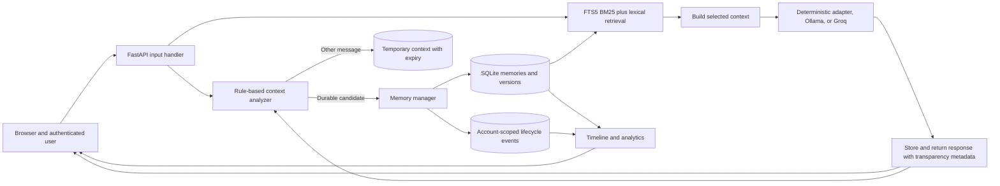
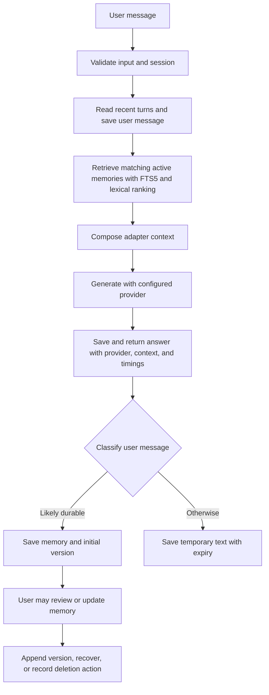

<div align="center">

# Memory Atlas

### An efficient, transparent, and user-controlled memory layer for long-running AI agents.

</div>

Memory Atlas explores how an AI agent can preserve useful information across conversations without repeatedly resending a growing transcript. It combines persistent, versioned memories with selective context retrieval and user controls for inspecting and changing what is kept.

This is a local proof of concept, not a new LLM or a conventional full-history chatbot. Memory decisions use inspectable rules and validated model analysis; retrieval combines SQLite FTS5 token search with lexical scoring. The default response provider is deterministic development mode; Ollama and Groq can be configured for LLM responses.

[](https://www.python.org/)
[](https://fastapi.tiangolo.com/)
[](https://www.sqlite.org/)
[](#project-status-and-future-work)

## Screenshots

No genuine screenshot of the current interface has been captured. Add images here after running the application in a browser. Use relative paths for repository images and a clean demo account; never publish credentials or private memories.

## Contents

- [Features](#features)
- [Architecture](#architecture)
- [Technology stack](#technology-stack)
- [Repository structure](#repository-structure)
- [Getting started](#getting-started)
- [Model configuration](#model-configuration)
- [How to use the application](#how-to-use-the-application)
- [API reference](#api-reference)
- [Testing and evaluation](#testing-and-evaluation)
- [Privacy, security, and limitations](#privacy-security-and-limitations)
- [Project status and future work](#project-status-and-future-work)
- [Contributing](#contributing)
- [License and acknowledgments](#license-and-acknowledgments)

## Features

| Area | Implemented behavior |
|---|---|
| AI Assistant | Authenticated chat, persistent conversation records, loading/error feedback, and a context inspector. |
| Conversation history | Multiple account-owned chats with automatic first-message titles, manual rename, ordered reload, and confirmed deletion. Conversation deletion removes its messages only; long-term memories remain separate. |
| Natural-language memory interpretation | With Groq configured, a lightweight local gate identifies likely personal assertions and personal-memory questions. Those messages receive a structured analysis for assertion type, user relevance, confidence, polarity, normalized candidate, and search terms. Python validates the output before use; only explicit, high-confidence personal assertions are retained. |
| Hybrid memory retrieval | SQLite FTS5 token matching/BM25 is combined with lexical overlap and priority. For analyzed messages, validated Groq-generated search terms expand the query. Deleted and temporary records are excluded, and retrieval is scoped to the signed-in user. |
| Safe Markdown responses | Assistant output is rendered with locally served, pinned Marked and DOMPurify builds. Sanitized Markdown supports headings, paragraphs, lists, tables, inline code, and fenced code. User messages remain plain text. |
| Safe fallback | If analysis fails or is malformed, chat continues with local phrase rules and ordinary lexical retrieval. Deterministic and Ollama modes do not call Groq for analysis. Questions, hypotheticals, likely jokes, and uncertainty are excluded by local fallback checks where recognizable. |
| Summarization and temporary context | When the stored message count reaches eight or more, recent user turns are condensed into an extractive summary. Other text is stored temporarily with a 24-hour expiry. Temporary rows are not independently retrieved into later prompts. |
| Memory controls | Search, category filtering, add, view, edit, version history, restore-as-new-version, soft delete, recovery, and confirmed permanent deletion. |
| Memory Universe | Interactive SVG nodes show actual active memories. A line appears only when two entries share at least two meaningful words; relationships are lexical and explainable, not semantic inference. An accessible list is available as an alternative. |
| Memory timeline | Existing version records show creation and edits. Delete, recovery, permanent-delete, and restore events are recorded going forward; past events that were never logged cannot be reconstructed. |
| Analytics | Account-scoped active/deleted counts, category totals, version count, and recorded lifecycle-event count. These are record statistics, not model-quality metrics. |
| Context Inspector | Shows response provider/model, request text, retrieved memories and reasons, adapter context, character-based token estimates, and measured retrieval and generation duration. |
| Model adapter | Clearly labeled deterministic development responses by default; optional local Ollama or GroqCloud inference. Provider keys remain server-side. No model downloads automatically. |
| Authentication and ownership | PBKDF2 password hashes, expiring bearer sessions, and owner-scoped API operations. |

## Architecture



### Chat and memory-update flow



Retrieval combines SQLite FTS5 token matching/BM25, lexical overlap, and priority; validated Groq query expansion is available only for likely memory-related messages. It does not use embeddings and may miss paraphrases without shared terms or model-expanded terms. `GET /api/health` reports the configured provider and model label, not whether an Ollama service is reachable. The inspector shows the exact prompt for Ollama and the inputs actually used by deterministic mode.

| Component | Code |
|---|---|
| Input handling, routes, and chat flow | `app/main.py` |
| Authentication and session ownership | `app/auth.py`, `app/main.py` |
| Classification, lifecycle, retrieval, timeline, analytics | `app/memory.py` |
| SQLite schema and additive initialization | `app/db.py` |
| Deterministic/Ollama/Groq provider adapter | `app/agent.py` |
| User interface | `static/index.html`, `static/style.css`, `static/app.js` |

More implementation detail is in [ARCHITECTURE.md](ARCHITECTURE.md).

## Technology stack

- **Python 3.10+ and FastAPI** for a small, testable backend with interactive OpenAPI docs.
- **SQLite** for local persistence without a separate database service. Initialization adds missing tables and indexes; it does not drop or recreate existing tables.
- **HTML, CSS, and vanilla JavaScript** for a responsive interface without a frontend build toolchain. Pinned Marked and DOMPurify browser builds are vendored under `static/vendor/` and served by FastAPI; their license texts are included beside the files.
- **Ollama (optional)** for local model generation, or **GroqCloud (optional)** for hosted OpenAI-compatible chat completions. Both are selected through the backend adapter; Groq uses the existing `requests` dependency.
- **`unittest` and pytest** for automated checks.

## Repository structure

```text
.
|-- app/
|   |-- __init__.py       # Loads local .env configuration
|   |-- agent.py          # Deterministic/Ollama/Groq adapter and prompt construction
|   |-- auth.py           # Registration, password hashing, bearer sessions
|   |-- db.py             # SQLite schema and additive initialization
|   |-- main.py           # FastAPI routes and chat lifecycle
|   `-- memory.py         # Classification, retrieval, versions, events, analytics
|-- evaluation/
|   |-- cases.json        # Small synthetic test set
|   `-- run.py            # Full-history vs selective-context evaluation
|-- static/
|   |-- app.js            # Chat, navigation, graph, memory and data views
|   |-- index.html        # Memory Atlas interface
|   |-- style.css         # Responsive midnight-indigo and violet theme
|   `-- vendor/           # Pinned Marked/DOMPurify builds and license texts
|-- tests/
|   |-- test_agent.py     # Provider tests, including mocked Ollama
|   |-- test_api.py       # Authentication, ownership and API workflows
|   |-- test_frontend.py  # Markdown sanitizer and local asset integration contracts
|   `-- test_memory.py    # Classification, versioning, retrieval and schema
|-- data/                 # Runtime SQLite database (ignored by Git)
|-- .env.example
|-- .gitignore
|-- ARCHITECTURE.md
|-- README.md
`-- requirements.txt
```

## Getting started

### Prerequisites

- Python 3.10 or later and pip.
- PowerShell on Windows, or a terminal on macOS/Linux.
- Internet access to install Python packages. Deterministic mode needs no model service.

### Windows PowerShell

Run from the repository root:

```powershell
py -m venv .venv
.venv\Scripts\Activate.ps1
python -m pip install --upgrade pip
python -m pip install -r requirements.txt
if (!(Test-Path .env)) { Copy-Item .env.example .env }
uvicorn app.main:app --reload
```

If activation is restricted, invoke the virtual-environment executables directly:

```powershell
.venv\Scripts\python.exe -m pip install -r requirements.txt
.venv\Scripts\python.exe -m uvicorn app.main:app --reload
```

Open <http://127.0.0.1:8000>, create an account, and sign in. FastAPI initializes the schema on startup and uses `DATABASE_PATH`; the example defaults to `data/memory.sqlite3`. Existing data is not reset by schema initialization.

### macOS and Linux

```bash
python3 -m venv .venv
source .venv/bin/activate
python -m pip install --upgrade pip
python -m pip install -r requirements.txt
if [ ! -f .env ]; then cp .env.example .env; fi
uvicorn app.main:app --reload
```

The frontend is served by FastAPI; no separate frontend server or build is required. Keep `.env` private and do not put credentials in browser code.

## Model configuration

The `.env.example` template uses deterministic mode by default:

```dotenv
DATABASE_PATH=data/memory.sqlite3
MODEL_PROVIDER=deterministic
OLLAMA_URL=http://localhost:11434/api/generate
OLLAMA_MODEL=llama3.2:3b
```

The deterministic adapter produces a labeled development response, not LLM output. To use Ollama, install Ollama separately, install a model suited to your machine, set `MODEL_PROVIDER=ollama`, verify `OLLAMA_URL` and `OLLAMA_MODEL`, and restart the API. For example, after installing Ollama:

```powershell
ollama pull llama3.2:3b
```

The application does not download models. Local inference uses local disk, memory, and compute. Live Ollama generation has not been verified in this environment.

### Optional hosted provider: GroqCloud

GroqCloud is the selected hosted option because its chat completions API is OpenAI-compatible and the existing `requests` dependency is sufficient. The model default is `openai/gpt-oss-20b`; check the [current model list](https://console.groq.com/docs/models) and your account's [free-plan limits](https://console.groq.com/docs/rate-limits) before use. Free access is rate-limited, can change, and is not guaranteed. Groq's current service agreement requires API users to be **18 or older**; account and regional eligibility also apply.

1. If eligible, create an account at [GroqCloud](https://console.groq.com/) and create an API key from its [API Keys page](https://console.groq.com/keys). Keep the key private; do not paste it into chat, source code, or browser developer tools.
2. In PowerShell, create `.env` if needed and open it locally: `if (!(Test-Path .env)) { Copy-Item .env.example .env }; notepad .env`. Keep the existing `DATABASE_PATH` unchanged. Set the provider variables in the local `.env` file:

   ```dotenv
   MODEL_PROVIDER=groq
   GROQ_API_KEY=your-key-added-locally
   GROQ_MODEL=openai/gpt-oss-20b
   GROQ_BASE_URL=https://api.groq.com/openai/v1/chat/completions
   ```

3. Save `.env`, stop the running server with `Ctrl+C`, then restart it with `uvicorn app.main:app --reload`. `GET /api/health` reports configured provider/model; it does not send a generation request or prove credentials work.
4. Sign in and send a non-sensitive test query. A genuine successful hosted response will show `groq` and the configured model in the context inspector. Rate-limit, invalid-key, and provider errors are surfaced; the app does not silently substitute deterministic text.

The Groq response adapter sends the current message, at most the three highest-ranked matching active memories, and at most two recent messages from that same authenticated conversation. For longer conversations, an extractive summary containing up to eight recent user messages may also be included. When memory interpretation is triggered, the current message may be sent separately in an additional analysis request. It does not send the database, account ID, or full conversation history. Inputs and outputs leave your machine and are sent over HTTPS to Groq. Groq states inference data is not retained by default, but may temporarily retain it for reliability/abuse investigations for up to 30 days unless Zero Data Retention is enabled; see [Groq's data handling documentation](https://console.groq.com/docs/your-data). Do not send secrets or information you cannot share with the provider. The provider may change its free limits, supported models, terms, or privacy practices; review the linked official pages before enabling it.

## How to use the application

1. Create an account with a username and a password of at least 10 characters, then sign in.
2. In **AI Assistant**, send “I prefer concise Python examples.” The rule-based classifier recognizes this as a likely durable preference and attempts to save it.
3. Ask “Can you show a Python example?” The context inspector shows any retrieved memory, its retrieval reason, the active provider, and estimated context sizes. Estimates use characters, not the model tokenizer.
4. In **Memory Universe**, select a node or its accessible list entry to view the saved content and metadata. Use **Edit** or **History** to change it or restore an older version as a new version.
5. In **All Memories**, search/filter records, soft-delete one, then switch to **Deleted / recovery** to recover it. Permanent deletion requires typing `PERMANENTLY DELETE`; the memory and versions are removed from the active SQLite database, while a content-free lifecycle audit event remains.
6. Review actual recorded version and lifecycle records in **Memory Timeline**. **Analytics** shows account-scoped counts, not inferred usage or model performance.

Classification is heuristic. Review entries and avoid storing credentials or highly sensitive information.

## API reference

With the application running, FastAPI's interactive documentation is at <http://127.0.0.1:8000/docs>.

| Method | Path | Access | Purpose |
|---|---|---|---|
| `GET` | `/api/health` | Public | Configured provider/model label; does not check provider availability. |
| `GET` | `/api/session-mode` | Public | Tell the frontend whether hosted cookie authentication is enabled. |
| `GET` | `/api/session` | Authenticated | Validate the current bearer or cookie session. |
| `POST` | `/api/register`, `/api/login` | Public | Create an account (invitation required when configured) or sign in. Local mode returns a bearer token; hosted cookie mode sets an HTTP-only cookie. |
| `POST` | `/api/logout` | Authenticated | Revoke the current session. |
| `POST` | `/api/chat` | Authenticated | Retrieve context, answer, update memory, and return provider/context/timing metadata. |
| `GET` | `/api/conversations` | Authenticated | List the signed-in user's conversations, ordered by most recent message. |
| `POST` | `/api/conversations` | Authenticated | Create an empty conversation (`title` defaults to `New chat`). |
| `GET` | `/api/conversations/{id}/messages` | Authenticated | Load an owned conversation's messages in creation order. |
| `PATCH` | `/api/conversations/{id}` | Authenticated | Rename a conversation without changing messages or memories. |
| `DELETE` | `/api/conversations/{id}` | Authenticated | Delete an owned conversation and its messages; long-term memories remain unchanged. |
| `GET` | `/api/memories?q=...` | Authenticated | Search active memories belonging to the user. |
| `POST` | `/api/memories` | Authenticated | Add a memory and initial version. |
| `PATCH` | `/api/memories/{id}` | Authenticated | Edit a memory and append a version. |
| `DELETE` | `/api/memories/{id}` | Authenticated | Soft-delete an active memory. |
| `GET` | `/api/memories/deleted?q=...` | Authenticated | Search soft-deleted memories. |
| `POST` | `/api/memories/{id}/recover` | Authenticated | Recover a soft-deleted memory. |
| `DELETE` | `/api/memories/{id}/permanent` | Authenticated | Permanently remove a soft-deleted memory and versions; body requires `{"confirmation":"PERMANENTLY DELETE"}`. Content-free audit metadata remains. |
| `GET` | `/api/memories/{id}/versions` | Authenticated | Read version history. |
| `POST` | `/api/memories/{id}/restore/{version}` | Authenticated | Restore a version as a new version. |
| `GET` | `/api/timeline` | Authenticated | Read account-scoped memory versions and recorded lifecycle actions. |
| `GET` | `/api/analytics` | Authenticated | Read account-scoped counts and category distribution. |

All authenticated memory and conversation operations enforce ownership in backend queries; frontend filtering is not the security boundary. Recent chat context is scoped to the selected conversation, while durable memory retrieval remains account-wide so relevant memories can be recalled in another chat by the same user.

Groq-assisted memory analysis is gated to likely personal statements/preferences and personal-memory questions; ordinary messages that do not match the inexpensive local gate do not incur the extra analysis request. When triggered, analysis adds one Groq completion request before response generation, increasing latency and rate-limit usage for those messages. The analysis request contains only the current message; saved memories and conversation history are sent only through the normal response-generation request when selected as context. Search expansion is model-assisted lexical matching, not embedding-based semantic retrieval, and falls back to lexical matching when analysis is unavailable.

Groq response instructions request natural Markdown, use the selected conversation's recent turns, ground personal-memory claims in retrieved context, acknowledge missing evidence, and disclose that live web lookup is unavailable. These are model instructions rather than factual guarantees. The app does not implement live web search. Assistant messages are formatted locally with Marked 18.0.14 and sanitized with DOMPurify 3.4.17; pinned assets are served from `static/vendor/` and no CDN is contacted at runtime.

### SQLite FTS5 search-index migration

On startup, `init_db()` creates an additive `memory_search_fts` FTS5 table and synchronization triggers when the installed SQLite build supports FTS5. The index is populated from active, non-temporary memories; soft-deleted content is removed from the index and reindexed on recovery. Permanent deletion removes its index row. Memory and version rows are not rewritten. SQLite builds without FTS5 continue with lexical-only retrieval.

Before applying this change to the existing local database, a consistent SQLite online backup was created at `data/memory.before_fts5_20261019_155034.sqlite3`; `.gitignore` excludes it. For another existing database, stop the app and take a SQLite-consistent backup before its first startup with this version. Restore by stopping the app and copying that backup over the database file. The index is derived and rebuildable; FTS5 is token-based hybrid retrieval, not vector semantic search.

### Hosting and production deployment

Memory Atlas serves its HTML, CSS, JavaScript, and API from one FastAPI origin. Browsers need no local software. The repository includes a Render Blueprint (`render.yaml`) for a **Free** Python web service with HTTPS at the host edge, secure HTTP-only cookie sessions, open registration, deterministic responses, and restricted proxy-header handling. It does not define a Render database or persistent disk. `autoDeploy: false` disables automatic deploys after setup; it does not prevent the initial Blueprint setup from creating the web service.

PostgreSQL is required in production and is selected with the secret `DATABASE_URL`. Startup refuses to run in production if this is missing, malformed, unreachable, or lacks the required application schema. SQLite remains supported for local development and tests only. The PostgreSQL database must be persistent and initialized before the web service starts.

PostgreSQL memory retrieval uses native `to_tsvector`/`to_tsquery` search backed by a GIN index. The PostgreSQL adapter uses SQLAlchemy and the pure-Python `pg8000` driver.

#### Free option and its limits

A zero-cost demonstration can use the Render Free web service in `render.yaml` with a separately created Neon PostgreSQL database. Create/configure Neon separately, then supply its connection URI as `DATABASE_URL` in the Render service's environment dashboard. The Blueprint marks this variable `sync: false`; never put its value in this repository. No Render-managed PostgreSQL resource is needed or defined. The PostgreSQL schema must be initialized before the web service starts; production startup validates the existing database and will fail if it is unavailable or missing the application schema. Render Free filesystems are ephemeral, and Free services cannot attach persistent disks. The application serves checked-in static assets from the repository and uses PostgreSQL for production records, so its normal production flow does not need persistent local files. ([Render Free limits](https://render.com/docs/free), [Render Blueprint secrets](https://render.com/docs/blueprint-spec))

The PostgreSQL adapter accepts standard `postgres://` and `postgresql://` Neon URIs. It uses pg8000 over certificate-verified TLS for remote hosts and removes libpq's `sslmode` and `channel_binding` options before connecting because pg8000 does not accept them. Neon requires TLS; its copied URL's `channel_binding=require` setting is not implemented by pg8000, while TLS certificate and hostname verification remain enabled. SQLAlchemy keeps a local connection pool with pre-ping and five-minute recycling; its default pool allows five persistent connections plus up to ten overflow connections per process. For web traffic, use Neon's pooled endpoint (`-pooler` hostname). Use a direct endpoint for the migration/setup tool, which performs schema DDL and table locks; Neon recommends direct connections for schema migrations and pooled connections for web applications. ([Neon connection strings](https://neon.com/docs/connect/connect-from-any-app), [Neon connection pooling](https://neon.com/docs/connect/connection-pooling))

Render Free services sleep after 15 minutes without inbound traffic, can take about a minute to wake, and may restart; Render describes Free services as suitable for testing and hobby projects rather than production. Free web services have 512 MB RAM and 0.1 CPU. Given this app's small FastAPI process, single default Uvicorn worker, external PostgreSQL, and deterministic provider (no model loaded in-process), it is likely to fit 512 MB for a low-traffic demonstration, but actual peak memory has not been measured. Neon Free has its own storage, compute, and recovery limits; check current provider terms before setup. ([Render Free limits](https://render.com/docs/free), [Neon plan limits](https://github.com/neondatabase/website/blob/main/content/docs/introduction/plans.md), [Neon recovery history](https://github.com/neondatabase/website/blob/main/content/docs/postgres/backup-restore/history-window.md))

The Free combination keeps database records off Render's ephemeral filesystem, but it has cold starts, usage limits, and weaker recovery guarantees than a paid production database. For public use with user-created memories, choose a database plan with backups and confirm the restore process. Do not treat a free tier as a backup strategy.

#### Production environment variables

Set these in the hosting provider's environment-variable/secret dashboard, never in source control or a build command:

| Variable | Production value / purpose |
| --- | --- |
| `APP_ENV` | `production`; enables production database validation and disables interactive API docs. |
| `DEMO_INVITATIONS_REQUIRED` | `false` for direct public registration; set `true` to require one-time invitations. This only changes registration; existing login still works. |
| `DATABASE_URL` | Required Neon PostgreSQL connection URI. Set it manually as a Render secret; its value is not stored in `render.yaml` or source control. |
| `SESSION_COOKIE_AUTH` | `true` to use HTTP-only session cookies in hosted mode. |
| `SESSION_COOKIE_SECURE` | `true`; required for production cookie authentication over HTTPS. |
| `ENABLE_HSTS` | `true` when HTTPS is enforced by the host. |
| `MODEL_PROVIDER` | The Blueprint defaults to `deterministic`, which needs no API key and is explicitly not an LLM. |
| `GROQ_API_KEY` | Optional secret, only when deliberately choosing `MODEL_PROVIDER=groq`. Never commit or paste it into documentation. Provider charges, limits, and data handling apply. |
| `PORT` | Supplied by Render; the configured start command binds to it. |

Other available safeguards include `MAX_REQUEST_BODY_BYTES`, registration/login/chat rate limits, and per-user/global Groq daily action limits. The latter counters are process-local and reset on restart; they are not provider billing caps. Review the values in `render.yaml` against expected traffic and configure provider-side spend limits if enabling a paid/usage-billed model.

Open registration does not include email verification, password reset, or account recovery. Users should choose a unique password of at least 10 characters and store it safely. The server enforces registration/login rate limits, and password hashing and per-user data scoping remain enabled.

For a local cookie-authentication smoke check, run the app over HTTPS and set both `SESSION_COOKIE_AUTH=true` and `SESSION_COOKIE_SECURE=true` in the process environment. Cookie mode omits the token from the login response and uses same-origin requests. Do not disable the secure-cookie flag on a public HTTPS deployment.

#### Prepare the PostgreSQL database and preserve existing data

Production startup validates PostgreSQL and refuses to create a production database or schema. Before deploying against a new PostgreSQL database, migrate the authoritative SQLite accounts and content:

1. Create a new, empty PostgreSQL database with your chosen provider. Keep its connection URI private. Migration refuses to proceed if any Memory Atlas application table in the target contains rows. It uses plain inserts; duplicate IDs or other database errors abort the transaction instead of updating destination rows.
2. Take and verify a consistent backup of the **authoritative** SQLite database. Confirm that `data/memory.sqlite3` is the intended source; if the actual current data lives in a different hosted database, export that database instead. Never replace hosted data with an older local copy.
3. Set `DATABASE_URL` in the shell running the migration without putting the URI in command history. For PowerShell, for example:

   ```powershell
   $secret = Read-Host 'PostgreSQL connection URI' -AsSecureString
   $env:DATABASE_URL = [System.Net.NetworkCredential]::new('', $secret).Password
   .venv\Scripts\python.exe -m scripts.migrate_sqlite_to_postgres --sqlite-path data/memory.sqlite3
   ```

   The first run is a read-only dry run. It does not initialize the schema or write to either database. Review the source counts and destination counts. Any count-query failure aborts; it is never interpreted as zero.
4. Only after verifying the empty target and source backup, apply the migration:

   ```powershell
   .venv\Scripts\python.exe -m scripts.migrate_sqlite_to_postgres --sqlite-path data/memory.sqlite3 --apply
   Remove-Item Env:DATABASE_URL
   ```

   The script opens the SQLite source read-only and migrates users, sessions, conversations, messages, memories, versions, invitations, temporary context, and events. Schema, rows, sequence restarts, and final count verification run in one PostgreSQL transaction; any failure rolls it all back. It uses plain `INSERT`, never upsert or delete. Review final row counts before configuring the web service. The SQLite source is not modified.
5. For the free demonstration, use the Free web service plan in `render.yaml`, create/configure Neon separately, and manually set Neon's pooled connection URI as the Render `DATABASE_URL` secret along with the production variables above. Use a direct Neon URI for the migration/setup command in steps 3–4. Do not add a Render-managed database. Render's proxy headers are deliberately not trusted by Uvicorn (see below).
6. Deploy manually, then verify `/api/health`, HTTPS, registration, login/logout, isolation using two synthetic accounts, restart persistence, and memory recovery/version flows before sharing the URL. A health response only reports the configured provider; it does not verify a Groq API key or model request.

Once registration is open, anyone who can reach the public site can create an account. Keep the repository private if it contains development history, never commit `.env` or database backups, and do not store API keys or database URIs in the repo. No public website URL exists until a real hosting deployment completes and is verified.

#### Optional invitation administration

`DEMO_INVITATIONS_REQUIRED=true` enables the existing one-time invitation gate without affecting existing sign-in. The invitation and account lifecycle commands operate on the database selected by `DATABASE_URL` or `DATABASE_PATH`; run them only from a trusted operator environment:

```sh
python -m app.demo_admin invite --expires-days 7
python -m app.demo_admin revoke-invite INVITATION_ID
python -m app.demo_admin disable-user TESTER_USERNAME
python -m app.demo_admin enable-user TESTER_USERNAME
```

An invitation is high-entropy, single-use, expires after 1–90 days, and only its hash is stored. Disabling an account revokes sessions but leaves its memories, conversations, and versions in place. These are operator commands, not public HTTP endpoints; protect access to the host shell and database.

#### Production request and proxy behavior

The Blueprint start command deliberately omits Uvicorn proxy-header parsing:

```sh
python -m uvicorn app.main:app --host 0.0.0.0 --port $PORT --no-proxy-headers
```

Uvicorn enables proxy-header parsing by default, so the explicit `--no-proxy-headers` flag matters. Render terminates HTTPS at its edge; the application sets secure cookies and HSTS from the configured environment variables and intentionally ignores `X-Forwarded-For` and `X-Forwarded-Proto`. On Render only, rate limits use the validated `CF-Connecting-IP` address supplied by Cloudflare; outside Render they use the immediate peer address. This avoids sharing one proxy-wide bucket among all Render visitors without trusting spoofable forwarded-header chains or enabling Uvicorn proxy-header parsing. Do not remove `--no-proxy-headers` or add `--forwarded-allow-ips='*'`. The app also limits request bodies, throttles registration/login/chat, adds browser security headers, and checks same-origin writes when cookie auth is enabled. Groq daily caps are per process and reset after restart; they are not hard billing controls.

SQLite and PostgreSQL initialization is additive (`CREATE TABLE IF NOT EXISTS` and guarded column additions); it does not drop or reseed existing records. Keep database-aware backups and test restoring them. Provider backups, logs, and retention policies are separate from application deletion; do not promise deletion from provider backups or logs.

## Testing and evaluation

Run the test suite from the repository root:

```powershell
python -m unittest discover -s tests -v
python -m pytest -q -p no:cacheprovider
```

Compile the Python modules:

```powershell
python -m compileall -q app tests evaluation
```

Tests use temporary databases and mocked Groq calls; no live model request is part of the suite. On Windows, if the default pytest temporary directory is inaccessible, pass a fresh writable path with `--basetemp` (for example, a new directory under `.venv`).

Run the baseline comparison:

```powershell
python evaluation/run.py
```

The evaluation uses the same three synthetic cases for: (A) the supplied history plus request, and (B) retrieved memories plus request. Token counts are `ceil(characters / 4)` estimates. Retrieval latency is measured locally; no model is called, so baseline model latency is not measured.

The last run reported estimated token reductions of 0.0%, 0.0%, and 53.8% for the three cases (17.9% mean), with 1.0 important-memory retention and retrieval relevance scores. These scores are computed against only two labeled memories and three examples; they are not evidence of general accuracy or production performance. Timings vary and are intentionally not recorded here. The script uses a temporary database, does not populate the application database, and does not quantify storage efficiency or response quality.

## Privacy, security, and limitations

- Memory, conversation, timeline, and analytics endpoints require a valid session and scope database access to the authenticated account. Cross-user access is covered by API tests.
- Passwords are salted PBKDF2-SHA256 hashes. Bearer tokens are stored as hashes, expire after seven days, and can be revoked.
- Local development stores a bearer token in local storage. Hosted cookie mode instead uses an HTTP-only, same-site cookie with HTTPS-only `Secure` configuration and same-origin checks for state-changing requests. The app is still a limited tester POC, not production-grade security; it lacks account recovery, email verification, encryption at rest, persistent/cluster-wide quotas, and a tested incident-response process.
- Registration, login, chat sends, and message-edit regenerations share process-local request throttles; on Render, throttling uses the validated Cloudflare client-IP header. Daily Groq action caps are also process-local and reset on restart.
- Classification and sensitive-text exclusion use simple rules plus gated model interpretation; FTS5/lexical retrieval can miss information or paraphrases. Avoid storing secrets and highly sensitive information.
- The Ollama prompt treats conversation and memory as untrusted data, but this does not guarantee protection from prompt injection. User text is sent to Ollama when that provider is configured.
- When GroqCloud is selected, the response request can include the current user message, up to three retrieved memory contents, up to two recent messages, and (in longer chats) an extractive summary of up to eight recent user messages from the owned conversation. A separate memory-analysis request may contain only the current message. The account identifier and database are not sent. Groq's stated default is no inference input/output retention, with limited temporary retention possible for reliability and abuse monitoring; review its current data policy before use.
- Temporary context expires after 24 hours but is not independently retrieved later. Conversation summaries are extractive and based on recent user turns.
- Initialization is additive. The `memory_events` table records lifecycle actions from its introduction; historical delete/recovery events cannot be reconstructed. Permanent deletion removes memory content and versions from the active database, but retains content-free account/record/action/time audit metadata. Backups, logs, and external copies are outside that operation.

## Project status and future work

**Status:** functional local proof of concept. The redesign has API and static-asset integration checks, but no browser-driven visual or interaction test suite. Live Ollama and Groq generation remain unverified here; Groq adapter behavior is covered with mocked API responses.

Possible next steps:

- Add browser-based accessibility and end-to-end tests; capture genuine screenshots using a clean demo account.
- Evaluate retrieval on a larger, independently labeled dataset with paraphrases and distractors.
- Move throttles and model quotas to shared storage if scaling beyond one process; add account recovery, email verification, encryption at rest, a backup and restore policy, and external security review before public hosting.
- Explore semantic retrieval while keeping memory decisions inspectable and user-controlled.

## Contributing

Open an issue with the behavior and expected result, make a focused change, and include tests and documentation for changed behavior. Run both test commands and `python evaluation/run.py`. Include actual output and note privacy/security implications. Do not submit credentials, private memories, database files, or fabricated evaluation results.

## License and acknowledgments

No license has been selected or included. Until a license is added, do not assume reuse, redistribution, or modification is permitted. The project uses Python, FastAPI, SQLite, and the optional Ollama runtime. No external contributors or institutional affiliations are claimed.
